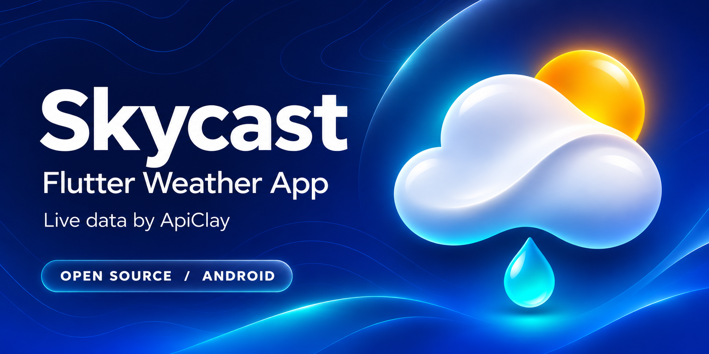
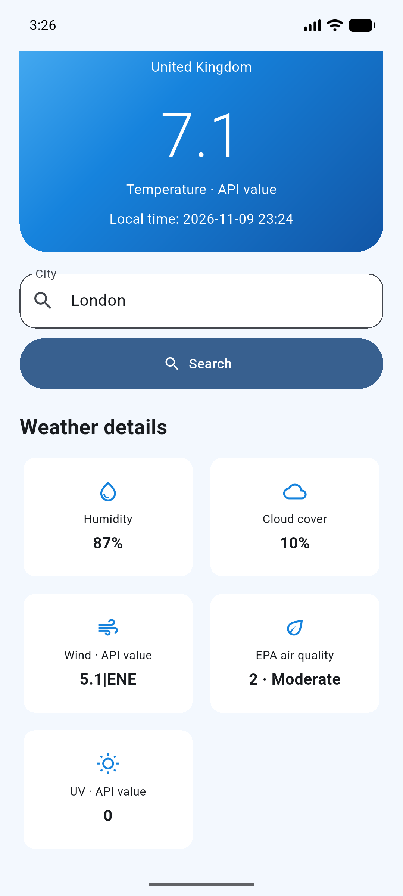
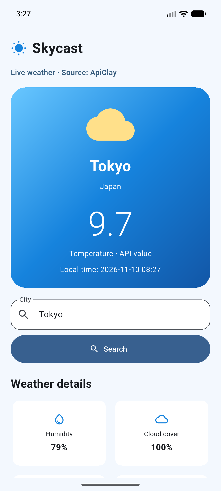

# Skycast — Flutter Weather App with ChatGPT and ApiClay

Build **Skycast**, a Flutter Android weather app, from an AI-generated interface to a working live-data app. Search a city, inspect temperature and wind values, humidity, cloud cover and the US EPA air-quality category. This is one app in one repository.

**Stack:** Flutter · Dart · Android · Node.js · ApiClay Weather API · ChatGPT

## What you will learn

- Write a UI prompt and run the generated Flutter files.
- Test London in the [real ApiClay Weather playground](https://apiclay.com/api/weather), inspect HTTP 200 and copy cURL.
- Replace the real token with a placeholder before sharing cURL with ChatGPT.
- Keep the token in a private local backend, connect Android, and test London and Tokyo.
- Use actual failed tests as the next AI prompt, then verify the repair.

## Before you start

Install [Flutter for Android](https://docs.flutter.dev/get-started/install), Android Studio with an emulator, and Node.js 22 or newer. Run `flutter doctor` and resolve the Android toolchain checks. Sign in to ApiClay and review the listing's current trial, usage price and terms. The MIT app source is free; API requests and content have separate terms.

## Run this app

Open a terminal in the folder containing `pubspec.yaml`.

```sh
flutter pub get
flutter analyze
flutter test
cd server
npm test
cp .env.example .env
```

Open `server/.env` in your local editor. Replace **only** `YOUR_APICLAY_TOKEN` with your account token, then save. Do this privately. Never paste your real token into ChatGPT, GitHub, screenshots or Flutter code. `.env` is ignored by Git.

Start the backend in that terminal:

```sh
npm start
```

Expected: `Skycast backend listening on 127.0.0.1:8787`. Leave this terminal running. In a second terminal, return to the app root and check the backend:

```sh
curl http://127.0.0.1:8787/health
curl 'http://127.0.0.1:8787/weather?q=London'
```

Expected: a healthy JSON response, followed by real London data. If it fails, recheck the token, trial/balance and the live ApiClay playground.

Start one Android emulator in Android Studio. Find its ID:

```sh
adb devices
adb -s emulator-5554 reverse tcp:8787 tcp:8787
flutter run -d emulator-5554
```

Replace `emulator-5554` if `adb devices` shows a different ID. Enter **London**, tap **Search**, inspect the values, then repeat with **Tokyo**. The app starts empty and makes no request until you search. The backend caches each city for five minutes and caps upstream attempts at 30 per hour for this local tutorial.

Stop Flutter with `q`, stop the backend with Ctrl+C, then remove the temporary connection:

```sh
adb -s emulator-5554 reverse --remove tcp:8787
```

Close the emulator when finished.

## Build it yourself with AI

The exact prompts are in `prompts/`, in numbered order. `tutorial/stage-1-main.dart.txt` and `tutorial/stage-1-widget_test.dart.txt` are the original UI checkpoint and repaired tests. Copy these into `lib/main.dart` and `test/widget_test.dart` only when following the UI-only stage. The root app is the completed live integration.

Use [github.dev](https://docs.github.com/en/codespaces/the-githubdev-web-based-editor) to read or edit published source. It has no terminal or Flutter runtime; run the commands above on your computer. Review code and secrets before publishing changes.

## Data and release notes

The Weather listing does not document the units of its numeric temperature and combined wind values. This app labels them as API values instead of inventing units. It does not invent forecasts or weather conditions. Cloud and humidity are shown as percentages; air quality is an EPA index category.

The backend binds only to this computer. Android cleartext traffic is enabled only for debug builds. For release, deploy an authenticated HTTPS backend and follow [ANDROID_RELEASE.md](ANDROID_RELEASE.md). This tutorial does not publish an app to Google Play.

## Recorded Android results

  

See [validation.json](docs/validation.json) for the recorded checks and their limits.

## License

MIT for this source code and included project artwork. The custom launcher icon and repository cover are in [docs/branding](docs/branding/README.md), with a 512px store icon and GitHub social preview. ApiClay and upstream data/content terms remain separate.
